# Forum Admin Handbook

Corporate Speakers & Programs | Strapi 5.61.1 | Version 1.0 | 10 November 2026

[Word](Forum-Admin-Handbook.docx) | [PDF](Forum-Admin-Handbook.pdf) | [HTML guide](Forum-Admin-Handbook.html)

This handbook documents the actual local Strapi admin used by the Forum MVP. Screenshots were captured from the running application in dark mode. The Dashboard, Inquiry, and Program screens shared in the request are covered by refreshed captures, together with other available main screens and key forms.

The temporary Documentation Preview account and sample inquiry are removed after capture. Existing admin credentials, permissions, and website content were not changed. Personal account email addresses are redacted; token values are not shown. Counts and timestamps are illustrative. External marketplace pages and paid-feature onboarding are outside this guide.

## Contents

- [1. Getting around the admin](#chapter-1)
- [2. Managing speakers](#chapter-2)
- [3. Managing programs](#chapter-3)
- [4. Reviewing contact inquiries](#chapter-4)
- [5. Working with images](#chapter-5)
- [6. Understanding the content models](#chapter-6)
- [7. Access, roles, and integration credentials](#chapter-7)
- [8. Other built-in Strapi settings](#chapter-8)

## 1. Getting around the admin

Sign in, understand the navigation, and manage your own preferences.

### 1.1 Sign in to Strapi

**Navigation:** http://localhost:1337/admin

The entry point for staff who manage website content.

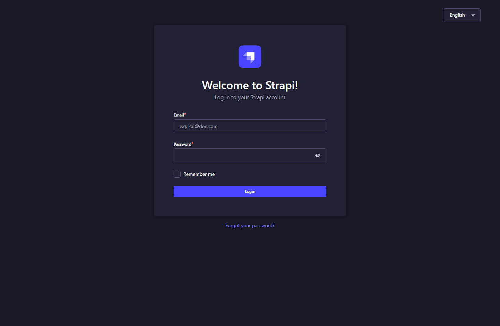

1. Enter your administrator email and password, then choose Login.
2. Use an account invited by an existing administrator. The website does not offer customer sign-in.
3. If the page cannot load, confirm PostgreSQL and Strapi are running; local startup steps are in LOCAL_SETUP.md.

**Note:** Do not share administrator passwords. Password recovery depends on a working email provider.

### 1.2 Dashboard and navigation

**Navigation:** Home icon in the left rail

A quick view of recent edits, published content, profile information, and project statistics.

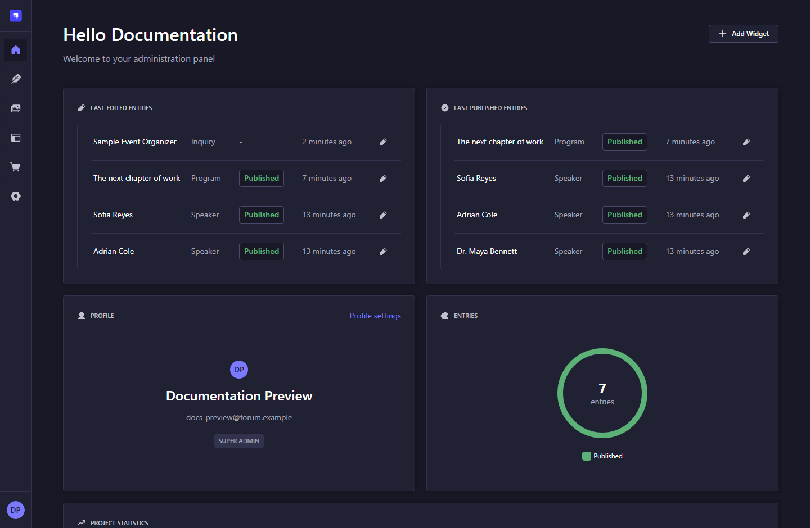

1. Select a recent entry to open it directly in Content Manager.
2. Use the left rail for Content Manager, Media Library, Content-Type Builder, and Settings.
3. Counts and timestamps change as content changes; they are not website analytics.

**Note:** The temporary Documentation Preview account and sample inquiry are shown for illustration. They are removed after capture.

### 1.3 Dashboard widgets

**Navigation:** Home > Add Widget

Choose from dashboard widgets that are not already displayed.

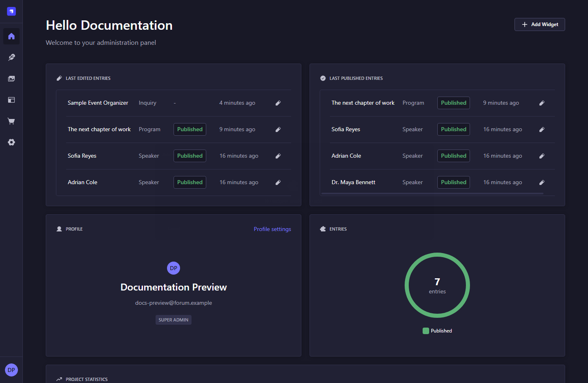

1. Select Add Widget to view available widgets.
2. In this capture all available widgets are already present, so the dialog reports that none can be added.
3. Close the dialog to return to the dashboard. Widget controls do not publish website content.

**Note:** The screenshot shows the current empty widget-selection dialog, not a missing application feature.

### 1.4 Your profile and preferences

**Navigation:** Profile avatar > Profile settings

Manage the signed-in administrator account and interface preferences.

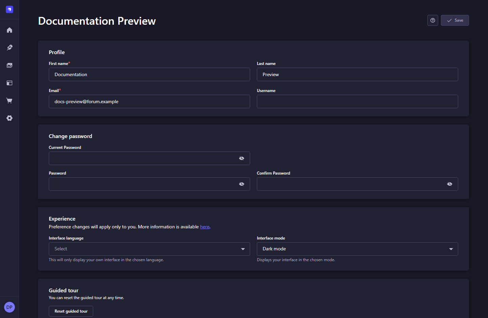

1. Edit your profile fields and choose Save when a change is intentional.
2. Use the password section to change your password; provide the required current password and confirmation.
3. Choose interface language and light/dark mode under Experience. Preferences apply to your account.

**Note:** Interface language changes the admin UI; it does not translate website content.

## 2. Managing speakers

Create a complete profile, publish it, and control homepage visibility.

### 2.1 Speaker collection

**Navigation:** Content Manager > Speaker

Find and manage all speaker entries, including draft and published profiles.

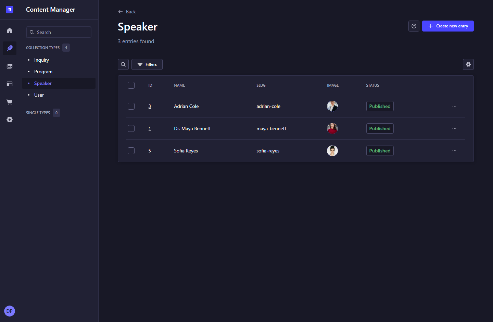

1. Choose Create new entry to add a speaker, or select an existing row to edit it.
2. Use Search and Filters to locate records; use column headers or View settings where available.
3. Check the Status column before expecting a profile to appear on the website.

**Note:** The list is an admin view. The public website only requests published content.

### 2.2 Create a speaker

**Navigation:** Content Manager > Speaker > Create new entry

Enter the speaker information that powers cards and the detail page.

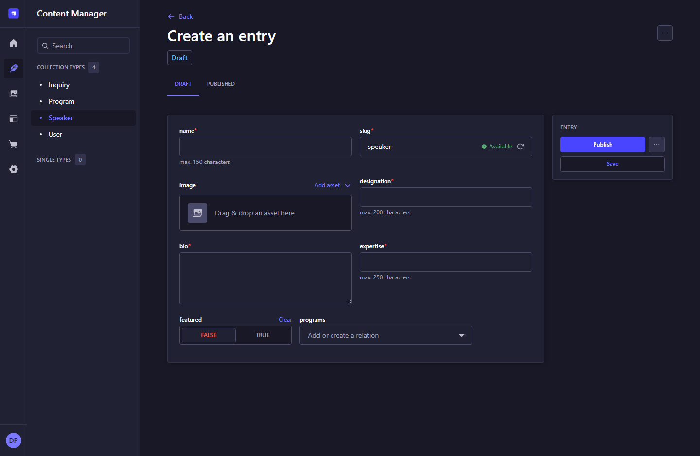

1. Fill name, slug, designation, bio, and expertise. Required fields have an asterisk.
2. Add one image, use a clear portrait, and provide meaningful alternative text in the media record.
3. Enter expertise as comma-separated topics. Set featured to TRUE when the profile should be eligible for the homepage.
4. Choose Save to keep a draft. Choose Publish when the profile is ready for public display.

**Note:** An example slug is maya-bennett. The public address becomes /speakers/maya-bennett.

### 2.3 Edit an existing speaker

**Navigation:** Content Manager > Speaker > select a row

Review and update profile text, imagery, featured status, and linked programs.

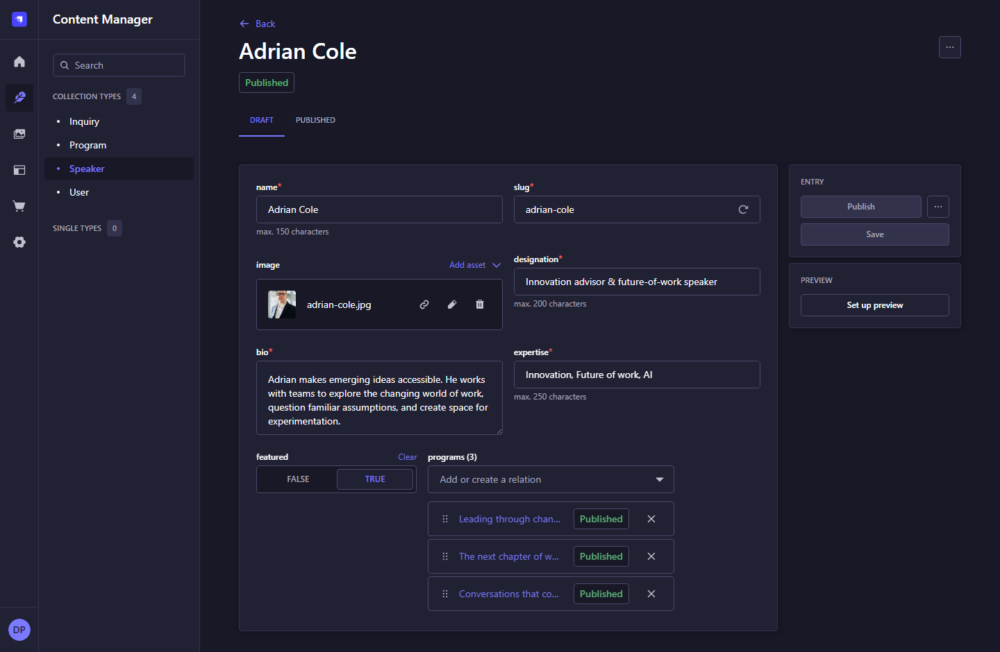

1. Edit the draft version and save your changes. Saving alone does not update the published version.
2. Choose Publish to make the revised content visible. Compare Draft and Published tabs when reviewing differences.
3. Keep the slug stable after publication. Changing it changes the public URL.
4. Open the corresponding public profile to verify the result.

**Note:** The programs field is the reverse side of the Program speakers relation. Publishing a speaker does not automatically publish a related program.

### 2.4 Publish, unpublish, and discard changes

**Navigation:** Entry editor > three-dot menu beside Publish

Manage the live version and any unpublished edits.

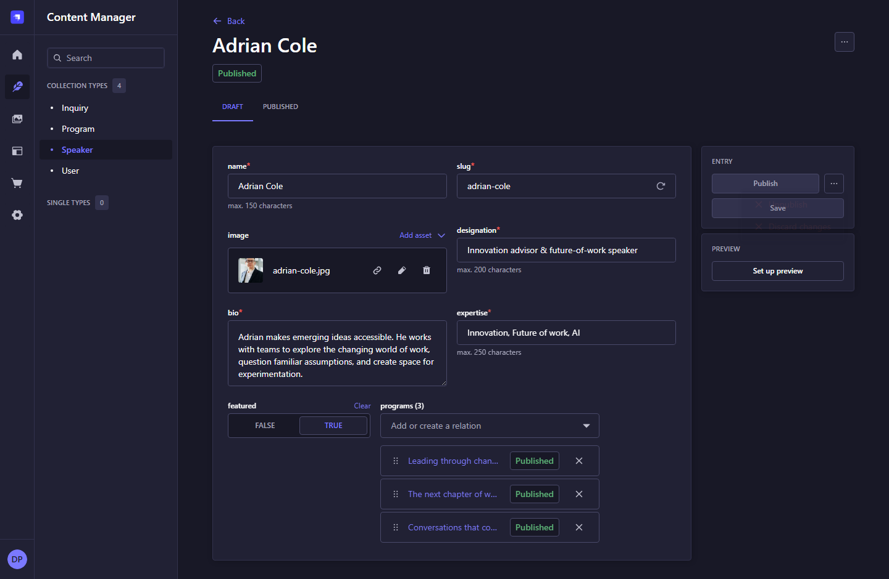

1. Choose Publish after checking required fields and content quality.
2. Open More document actions to see Unpublish and Discard changes when available.
3. Unpublish removes the live version from public listings and detail pages; it keeps the record in the CMS.
4. Discard changes removes unpublished edits. Use the entry or row action menu for Delete only when permanent removal is intended.

**Note:** Do not confuse Save with Publish. Deleting an entry is different from unpublishing it.

### 2.5 Find records with filters

**Navigation:** Content Manager > a collection > Filters

Narrow the admin list without changing content.

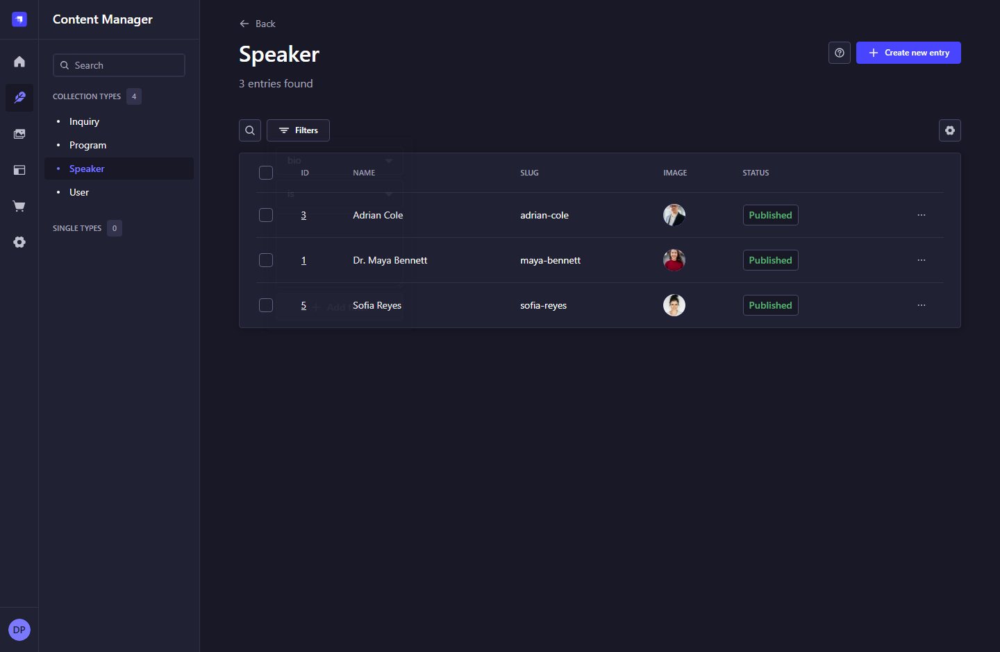

1. Choose a field and comparison, then enter the value to filter by.
2. Add another condition when a narrower result is needed.
3. Clear the search and filters before concluding that an entry is missing.

**Note:** Admin list filtering is separate from the public website, which has no advanced search in this MVP.

## 3. Managing programs

Maintain program descriptions, images, durations, and related speakers.

### 3.1 Program collection

**Navigation:** Content Manager > Program

Review available program entries and their publication status.

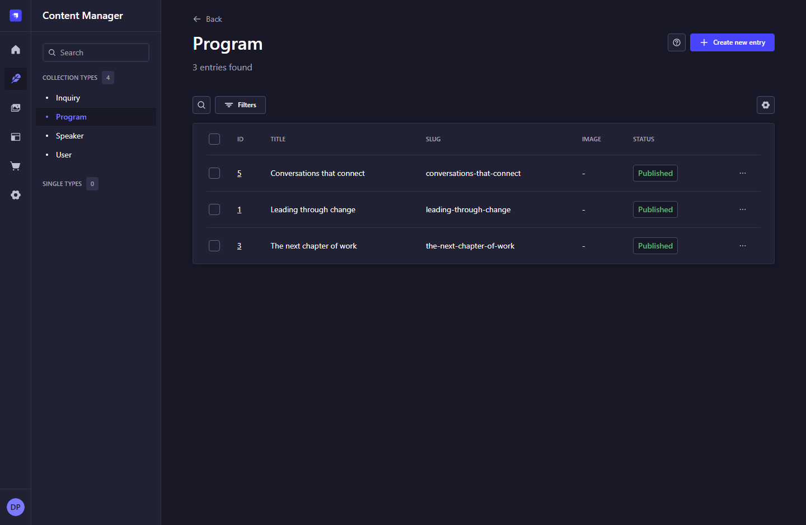

1. Select a row to inspect or edit a program.
2. Choose Create new entry to add a program.
3. Check its slug and status before testing the public detail page.

**Note:** A dash in the Image column means no media is attached. The frontend displays a designed visual fallback.

### 3.2 Create a program

**Navigation:** Content Manager > Program > Create new entry

Define a learning experience for the program cards and detail page.

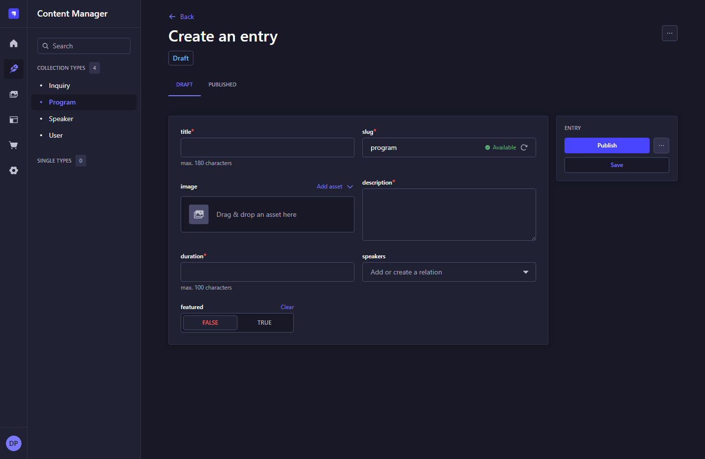

1. Fill title, slug, description, and duration. Duration is readable text, such as Half-day workshop.
2. Add one program image when available. Use paragraph breaks in description; it is plain text, not an HTML editor.
3. Choose related speakers in the speakers relation field. Publish those speaker profiles as well.
4. Set featured to TRUE if appropriate, then Save and Publish when ready.

**Note:** The public detail URL follows /programs/<slug>. No booking, payment, or scheduling engine is connected to duration.

### 3.3 Edit a program and its speakers

**Navigation:** Content Manager > Program > select a row

Update the published experience and the speaker cards associated with it.

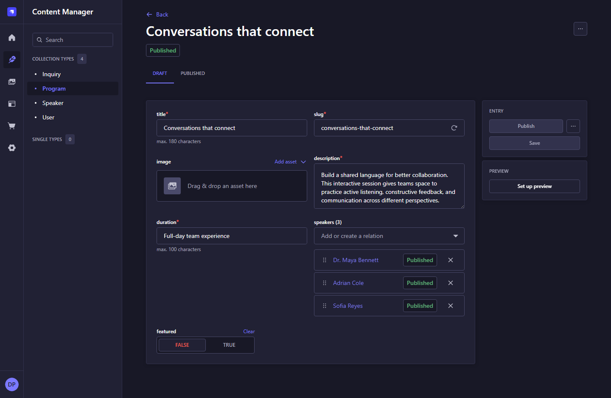

1. Review description, duration, image, and featured status.
2. Use the relation selector to add speakers; use the remove control to detach a relation. This does not delete the speaker.
3. Save the draft, then Publish the program to apply changes to the website.
4. Verify the program detail page and its facilitator section.

**Note:** The homepage displays up to two featured programs. Public programs are sorted by title, not by manual relation order.

## 4. Reviewing contact inquiries

Find and read messages submitted through the website contact form.

### 4.1 Inquiry collection

**Navigation:** Content Manager > Inquiry

View contact requests stored securely in Strapi.

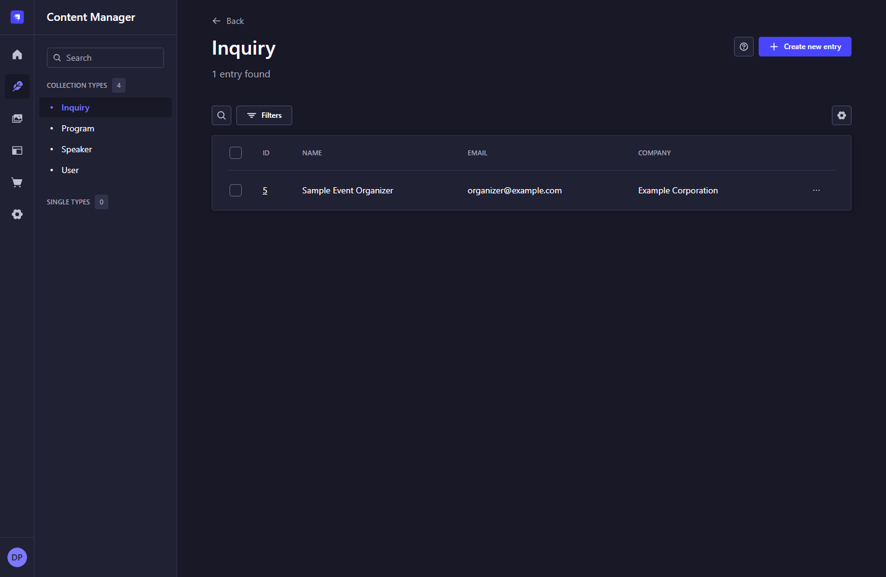

1. Open the collection to see the sender, email, and company.
2. Select a row to read the complete message and submission date.
3. Use Search or Filters to find a sender or organization.

**Note:** The example inquiry in these captures is temporary documentation data. Real inquiries are not publicly listed.

### 4.2 Read an inquiry

**Navigation:** Content Manager > Inquiry > select a row

Review the information needed for a human follow-up.

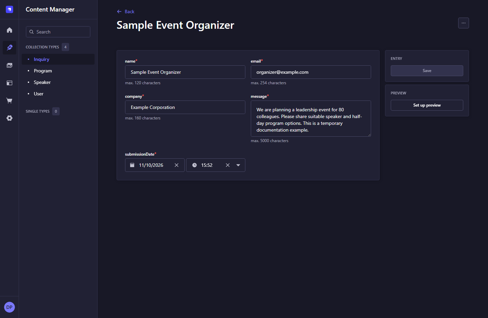

1. Read name, email, company, message, and submissionDate.
2. Contact the sender through your normal business communication process.
3. Keep the original message and timestamp intact unless correcting a documented data-entry error.

**Note:** There is no Publish action, response-status workflow, or automatic email notification for inquiries in this MVP.

### 4.3 Empty inquiry results

**Navigation:** Content Manager > Inquiry > empty or filtered list

Understand the No content found state.

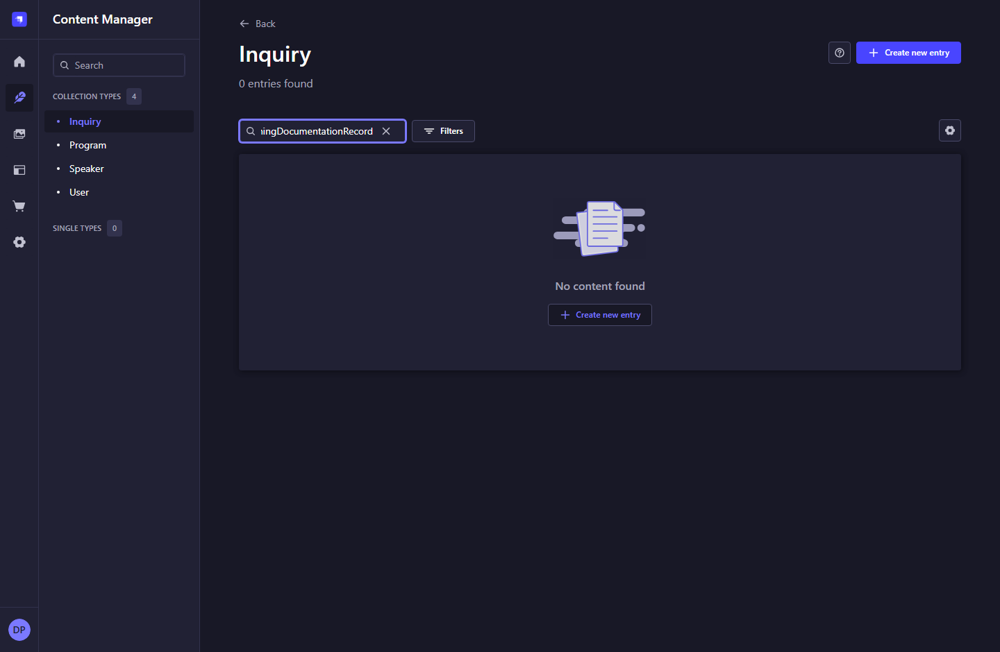

1. If a search or filter is active, clear it to see all available records.
2. If no inquiries have been submitted, this state is expected.
3. To test the actual intake flow, submit the website Contact form and return to this list.

**Note:** This screenshot uses a search with no matches. An empty collection displays the same no-content result.

### 4.4 Manual inquiry entry

**Navigation:** Content Manager > Inquiry > Create new entry

A standard Strapi form that can be used for intentional manual data entry.

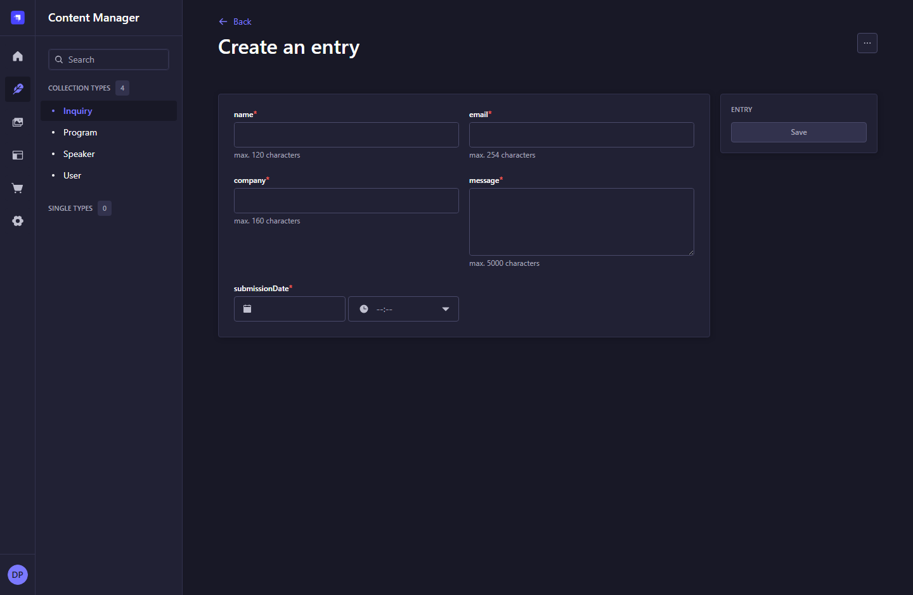

1. Normal inquiries should arrive through the website contact form.
2. For a manual record, fill all required sender, company, message, and date fields and choose Save.
3. A manually created entry does not prove that the website submission flow is working.

**Note:** The website and CMS intake endpoint set the submission date on the server. The generic admin form permits authorized staff to enter it manually.

## 5. Working with images

Upload assets, select them in entries, and maintain useful metadata.

### 5.1 Media library and folders

**Navigation:** Media Library > API Uploads

Browse and manage the uploaded speaker portraits and other assets.

1. Open a folder to see its contents. The API Uploads folder contains the current sample portraits.
2. Use search, sorting, filters, or grid/table view to find an image.
3. Select an asset to inspect its metadata, or use New to add files or folders.

**Note:** The Home folder can be empty while assets exist inside API Uploads.

### 5.2 Upload files and organize folders

**Navigation:** Media Library > New

Choose how an asset is added to the library.

1. Choose File upload to select an image from your computer.
2. Choose New folder to organize media, or File upload from URL when appropriate.
3. After uploading, return to the speaker/program image field and choose Add asset to attach the file.

**Note:** Uploading an image alone does not assign it to a speaker or program. Attach it to the entry and publish that entry.

### 5.3 Asset details and alternative text

**Navigation:** Media Library > select an asset

Inspect dimensions and file size, and maintain image metadata.

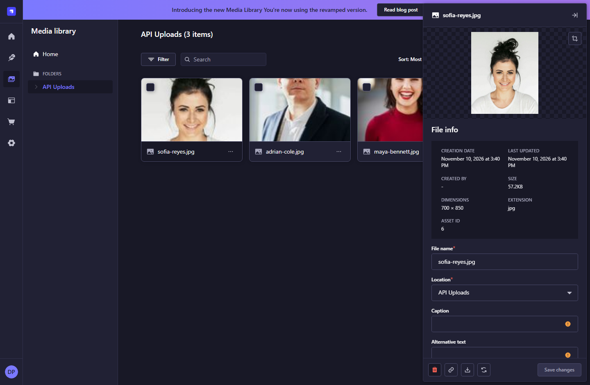

1. Check the preview, file name, dimensions, and location.
2. Add meaningful Alternative text that describes the image; scroll the details panel if necessary.
3. Choose Save changes after an intentional metadata edit.
4. Avoid deleting assets that are still used by a published profile or program.

**Note:** The included portraits illustrate fictional sample speakers. Replace them with approved real assets before launch.

### 5.4 Import an image from a URL

**Navigation:** Media Library > New > File upload from URL

Import a remotely hosted asset into the media library.

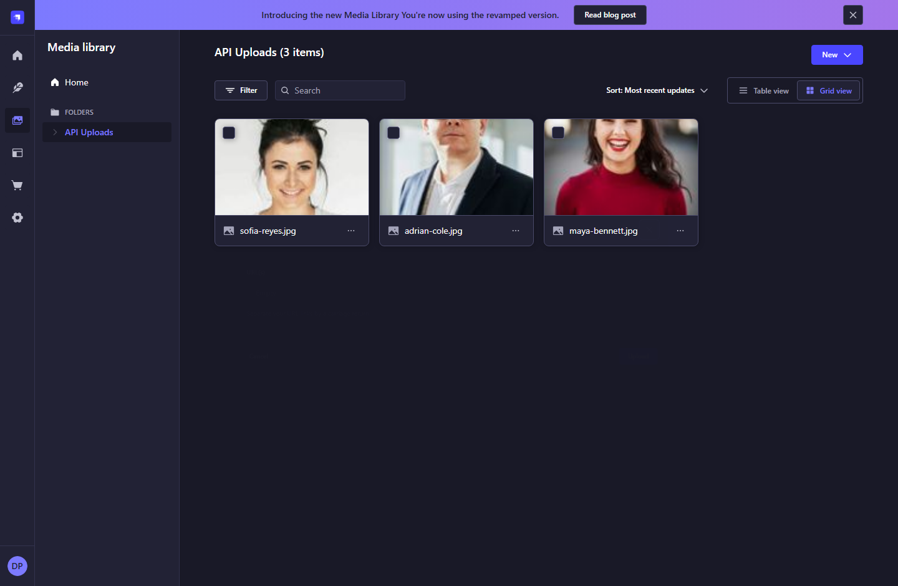

1. Enter the image URL in the Import from URL dialog.
2. Use a separate line for each additional URL, as indicated by the dialog.
3. Choose Upload only for assets you are authorized to use, then attach the imported image to an entry.

**Note:** This screen is documented for completeness. No remote imports were submitted while producing this guide.

## 6. Understanding the content models

Reference the existing schema; content editing belongs in Content Manager.

### 6.1 Speaker content model

**Navigation:** Content-Type Builder > Speaker

The structure of a speaker entry, including its reverse program relation.

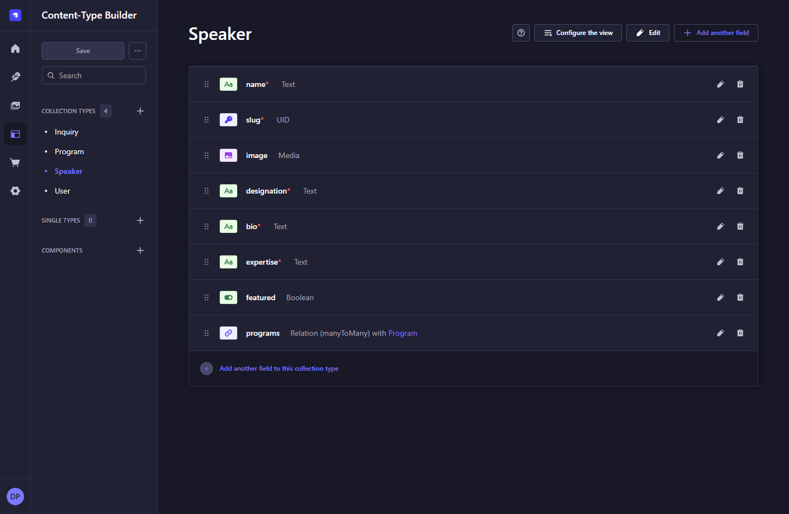

1. Review name, slug, image, designation, bio, expertise, featured, and programs.
2. Use Content Manager for routine record creation and editing.
3. Coordinate field additions, removals, or type changes with the developer so the frontend and database remain compatible.

**Note:** Content-Type Builder is a development tool. Schema editing may be unavailable in a production Strapi deployment.

### 6.2 Program content model

**Navigation:** Content-Type Builder > Program

The structure of program content and its many-to-many speaker relation.

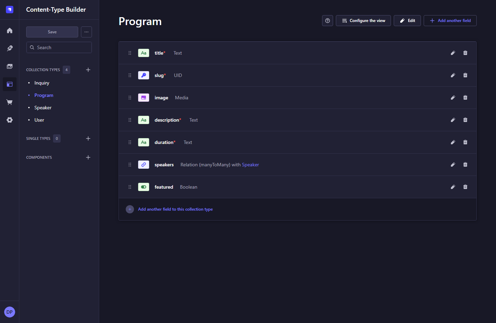

1. Review title, slug, image, description, duration, speakers, and featured.
2. One program can reference several speakers, and a speaker can belong to several programs.
3. The model supports Draft & Publish. Relation changes must be published with the entry to reach the website.

**Note:** Removing a relation is different from deleting either related record.

### 6.3 Inquiry content model

**Navigation:** Content-Type Builder > Inquiry

The private contact-submission model.

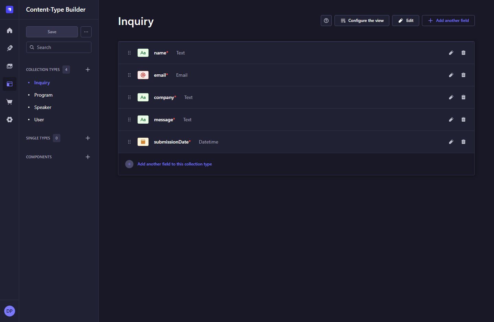

1. Review name, email, company, message, and submissionDate.
2. Inquiries have no Draft & Publish workflow.
3. Keep public role permissions disabled for this collection; the website uses a separate create-only server token.

**Note:** Do not add customer login, booking, or payment fields as part of routine content administration.

## 7. Access, roles, and integration credentials

Administrator-only screens for staff access and the server connection.

### 7.1 Application settings overview

**Navigation:** Settings > Overview

View the application version, plan, branding controls, and support links.

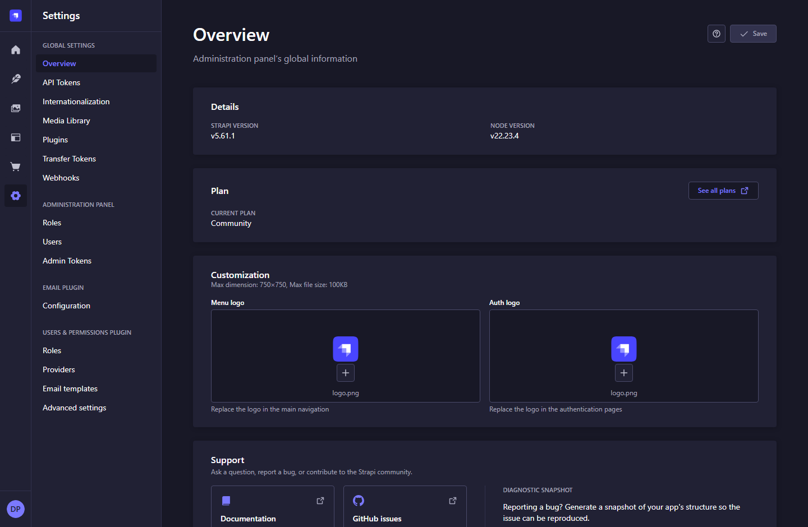

1. Use this page to confirm the Strapi application information.
2. Menu and authentication logos are admin branding controls, separate from the Next.js website design.
3. Coordinate application configuration changes with the developer.

**Note:** The Community plan and available controls reflect the currently installed local application.

### 7.2 Content API tokens

**Navigation:** Settings > Global Settings > API Tokens

Manage credentials used by server-side integrations with the content REST API.

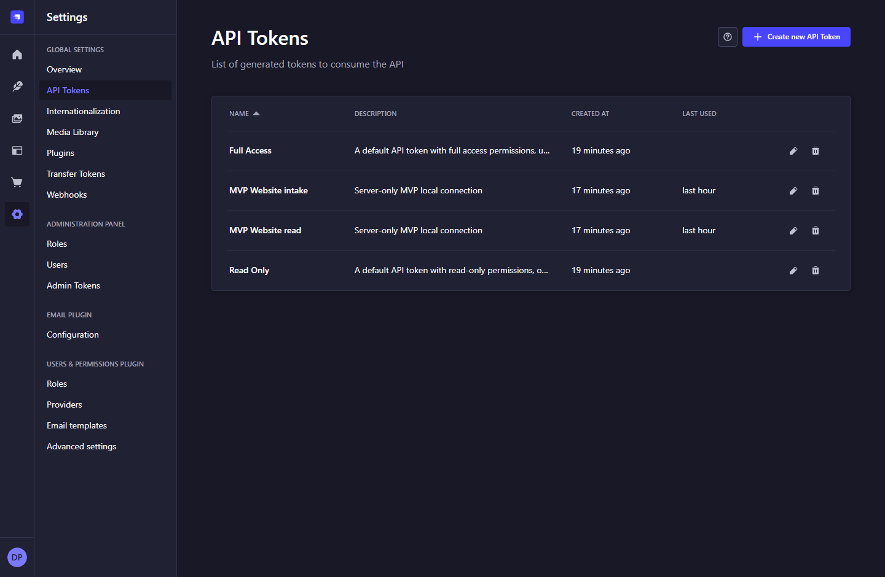

1. The website uses separate content-read and inquiry-create custom tokens.
2. Do not use a Full Access token as the website credential.
3. If rotating a website token, update the matching server environment variable and restart Next.js.

**Note:** Token values are intentionally absent from this document. API Tokens differ from Admin Tokens.

### 7.3 Create a custom API token

**Navigation:** Settings > API Tokens > Create new API Token

Configure a token with a specific purpose and limited actions.

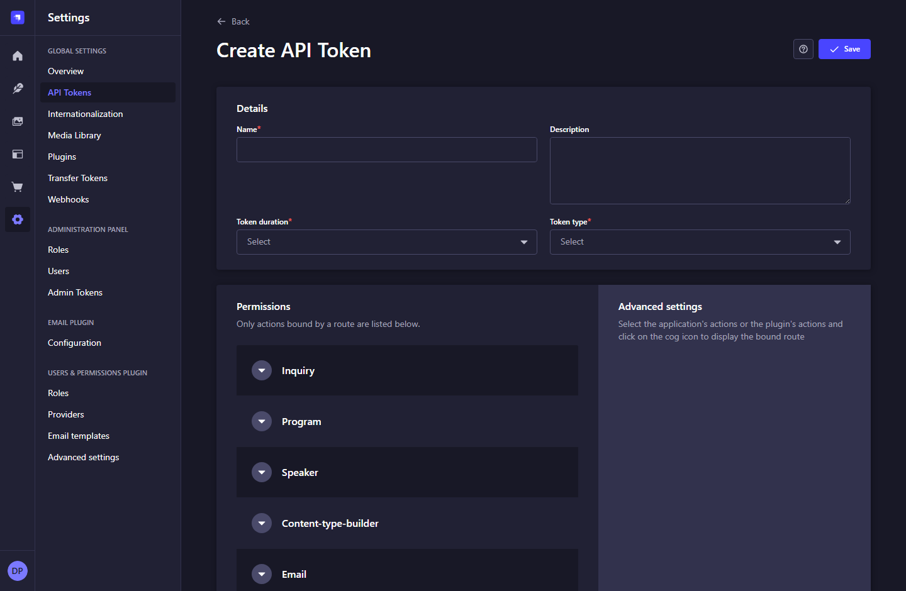

1. Provide a clear name, description, duration, and Custom token type.
2. For website content, allow Speaker find/findOne and Program find/findOne only.
3. For inquiry intake, allow Inquiry create only; do not grant find, update, or delete.
4. Save the token, then store its value only in the relevant server environment variable.

**Note:** Use STRAPI_READ_TOKEN and STRAPI_INQUIRY_TOKEN in apps/web/.env.local. Never put either token in a NEXT_PUBLIC variable.

### 7.4 Administrator accounts

**Navigation:** Settings > Administration Panel > Users

Review the staff accounts that can access Strapi.

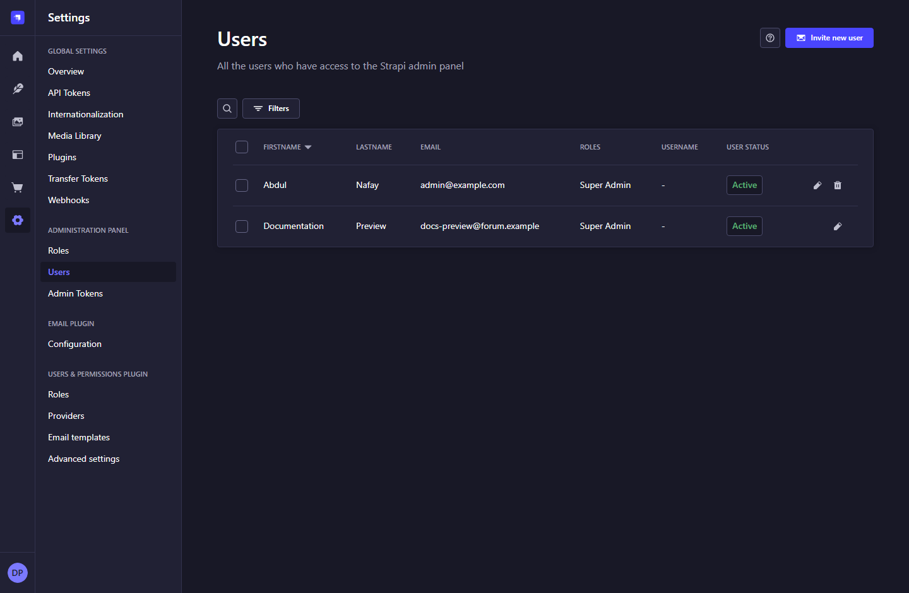

1. Check each account role and Active status.
2. Use Invite new user to onboard a staff member.
3. Deactivate or remove departed staff through the available account actions, following your organization process.

**Note:** These are administrator accounts. They are separate from the User collection supplied by Users & Permissions.

### 7.5 Invite a staff administrator

**Navigation:** Settings > Users > Invite new user

Enter a new staff member and choose the role they require.

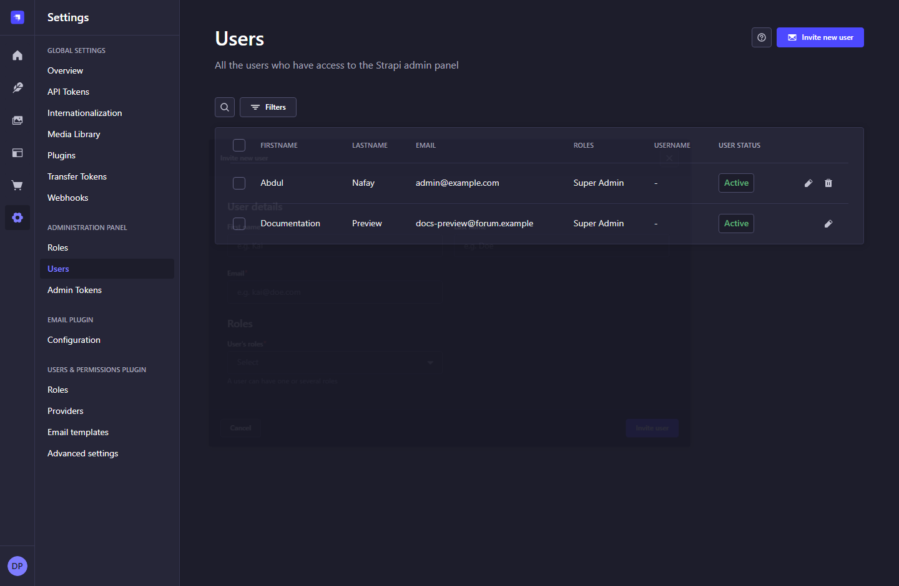

1. Fill first name, email, and the required role selection. Last name is optional.
2. Choose an appropriate role rather than giving every staff member Super Admin access.
3. Review the details before choosing Invite user; follow the registration instructions returned by Strapi.

**Note:** This guide only opened the invite dialog. No invitations were sent.

### 7.6 Administrator roles

**Navigation:** Settings > Administration Panel > Roles

Review the built-in Author, Editor, and Super Admin roles.

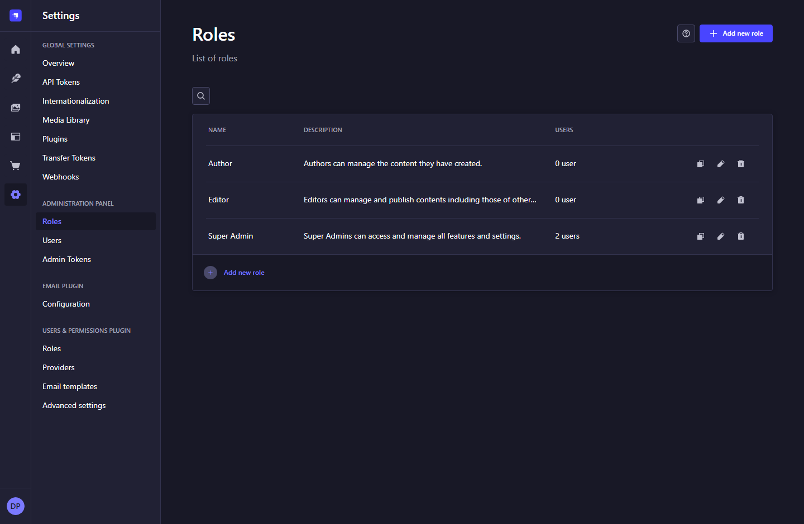

1. Open a role to inspect its actual permissions before assigning it.
2. Use content permissions for daily editors and reserve application settings for administrators.
3. Duplicate or add a role when a deliberately scoped role is needed.

**Note:** Default role descriptions are not a substitute for reviewing the configured permission matrix.

### 7.7 Role permissions matrix

**Navigation:** Settings > Administration Panel > Roles > Editor

Configure access to collections, plugins, and settings.

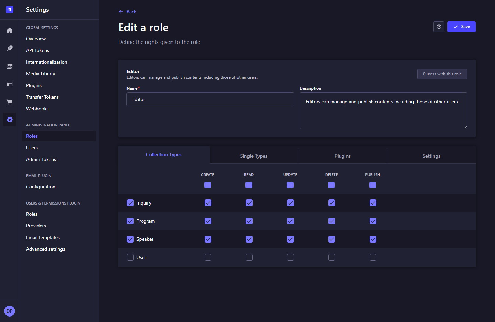

1. Review Create, Read, Update, Delete, and Publish permissions per collection.
2. Use the Plugins and Settings tabs to inspect additional access.
3. Choose Save only after reviewing the intended permissions with the application owner.

**Note:** The documentation capture did not change role permissions.

### 7.8 Create an administrator role

**Navigation:** Settings > Roles > Add new role

Define a named role and the access it should grant.

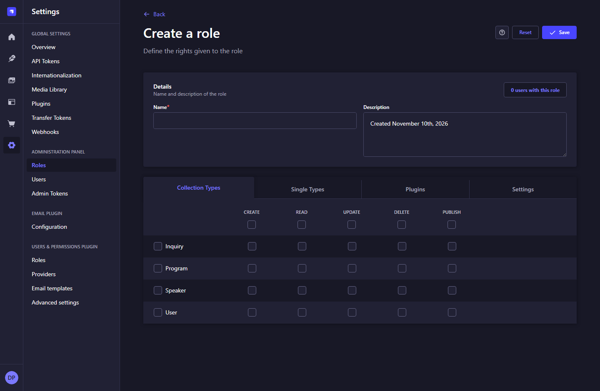

1. Enter a clear role name and description.
2. Select only the collection actions needed by the role.
3. Review plugin/settings access, save the role, and assign it to an appropriate administrator.

**Note:** A role does not create a user. Assign roles from the administrator user or invite workflow.

### 7.9 Administrative API tokens

**Navigation:** Settings > Administration Panel > Admin Tokens

Manage programmatic access to admin features.

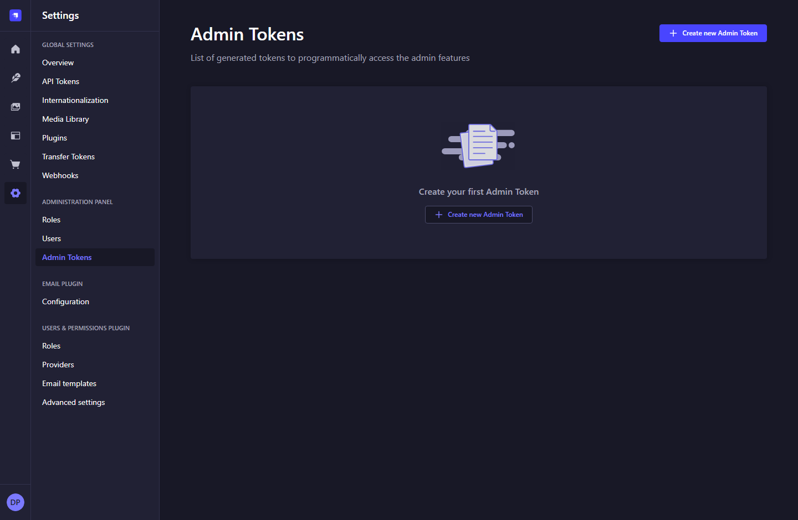

1. Review existing tokens and their purpose before making changes.
2. The website content client does not need an Admin Token.
3. Use content API tokens for the Next.js REST connection described earlier.

**Note:** This optional built-in capability is not required for operating the MVP website.

### 7.10 Create an administrative token

**Navigation:** Settings > Admin Tokens > Create new Admin Token

Set up a deliberately scoped admin automation credential when required.

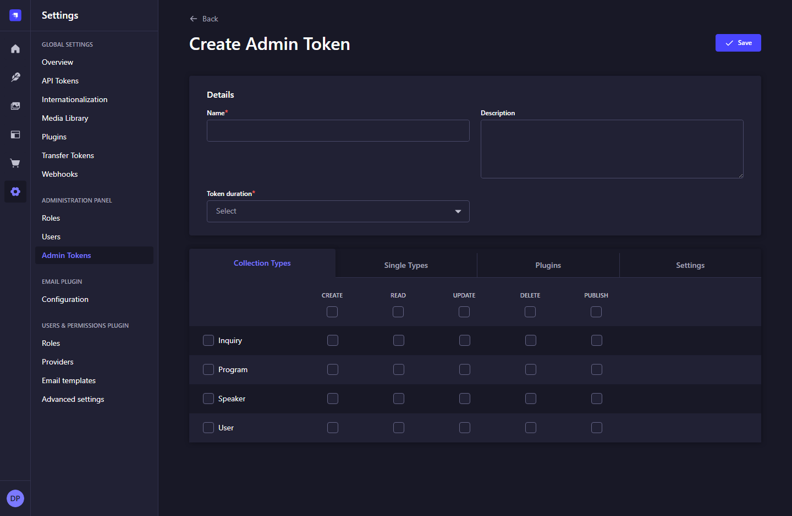

1. Enter name, description, and duration.
2. Review the collection, plugin, and settings permission tabs.
3. Create this credential only for a specific administrative integration, and keep it out of browser code.

**Note:** No Admin Token was created during documentation. This screen is included for completeness.

## 8. Other built-in Strapi settings

Reference screens included with Strapi; most are outside daily MVP operations.

### 8.1 Application API roles

**Navigation:** Settings > Users & Permissions Plugin > Roles

View Public and Authenticated permissions for application users.

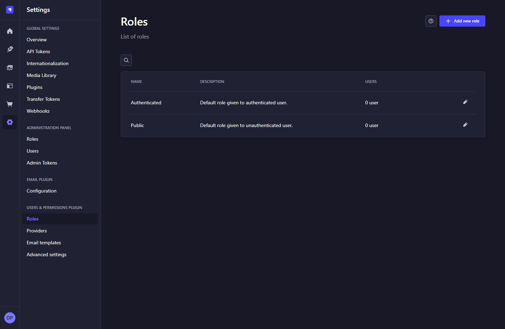

1. Distinguish these roles from administrator roles.
2. Public represents requests without an application-user login.
3. Open a role to inspect the allowed content API actions.

**Note:** The Next.js website uses scoped server tokens and has no customer sign-in feature.

### 8.2 Public content permissions

**Navigation:** Settings > Users & Permissions > Roles > Public

Inspect which actions unauthenticated API requests may use.

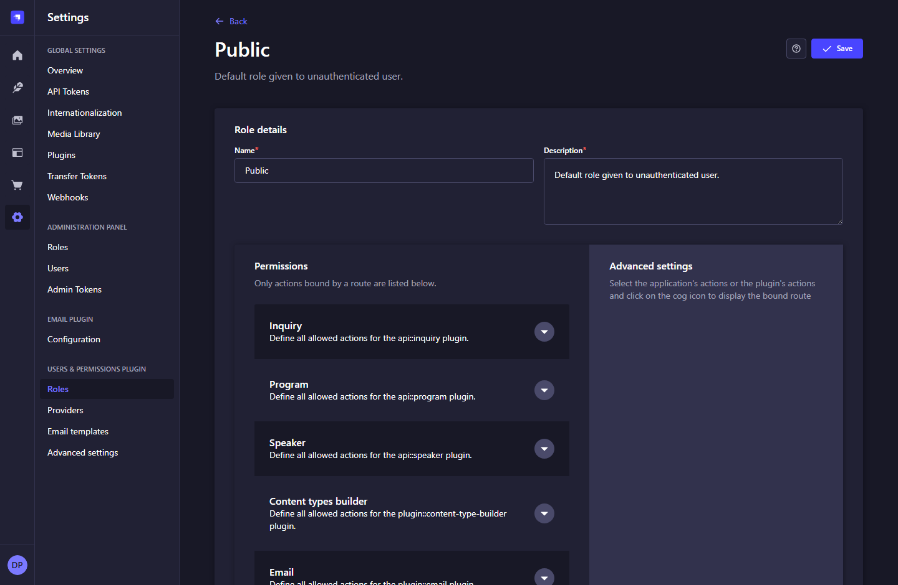

1. Keep all Inquiry actions unchecked for Public and Authenticated roles.
2. Speaker and Program public actions may also remain disabled because the website fetches with its server token.
3. Do not enable public inquiry reads as a way to make the contact form work.

**Note:** The contact form posts to the Next.js endpoint, which calls Strapi with the create-only intake token.

### 8.3 Application-user collection

**Navigation:** Content Manager > User

A default collection installed by the Users & Permissions plugin.

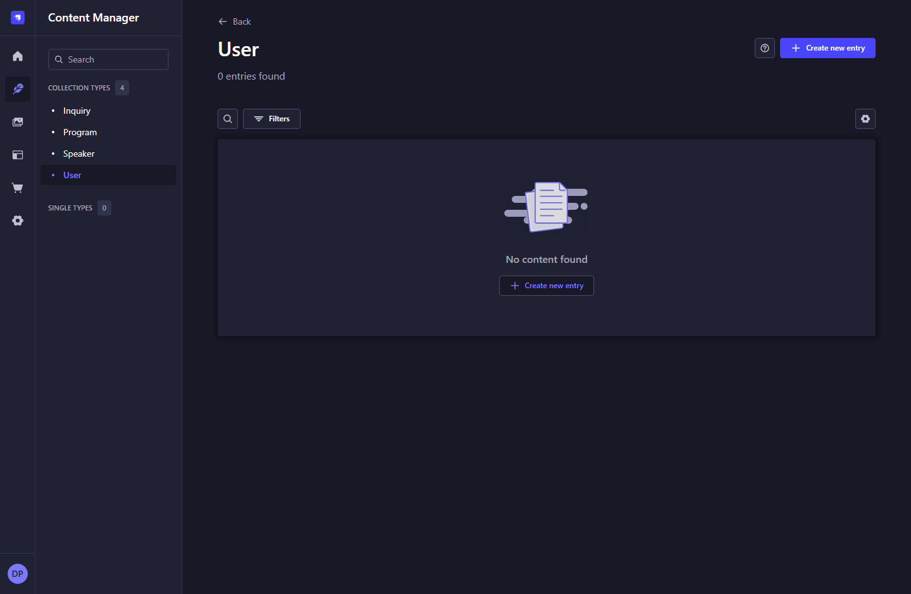

1. This collection contains application-user records, not Strapi administrators.
2. Use Settings > Administration Panel > Users to manage staff.
3. Leave this collection unused for the current website unless a separately approved requirement introduces customer accounts.

**Note:** Seeing this default User collection does not mean customer login has been implemented.

### 8.4 Application authentication providers

**Navigation:** Settings > Users & Permissions > Providers

View the plugin provider settings bundled with Strapi.

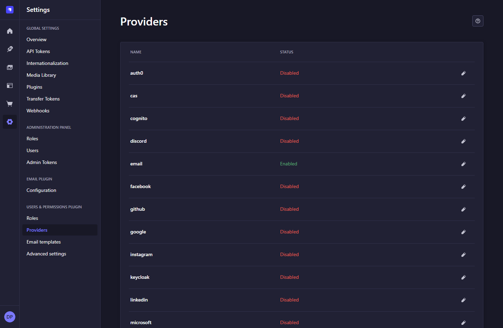

1. The screen lists email and external authentication providers.
2. Leave provider configuration to a separate authentication requirement.
3. Changing these providers does not configure the Next.js contact form or administrator roles.

**Note:** Provider screens are documented as built-in settings; the MVP website does not use them.

### 8.5 Application-user email templates

**Navigation:** Settings > Users & Permissions > Email templates

Review templates for application-user password reset and email confirmation.

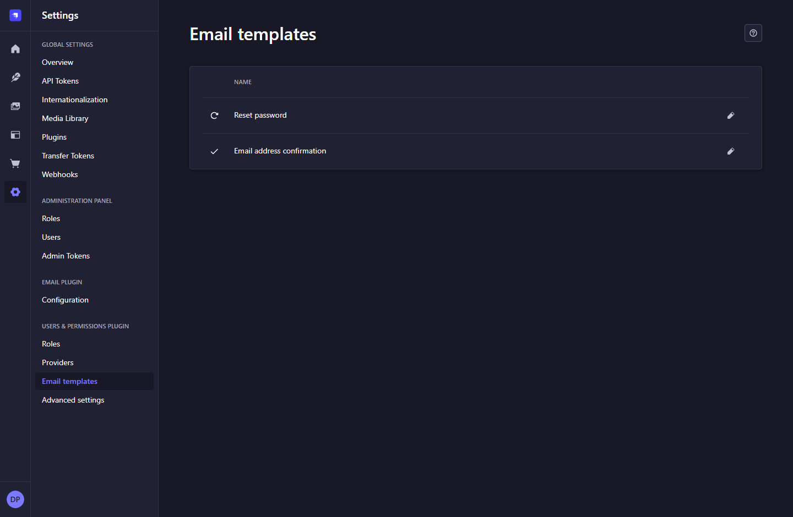

1. Select a template to inspect its sender, subject, and body where editing is permitted.
2. Coordinate template changes with the developer and a working email provider.
3. Do not expect these templates to create contact inquiry notifications.

**Note:** Inquiry notification emails are outside the current MVP.

### 8.6 Application-user advanced settings

**Navigation:** Settings > Users & Permissions > Advanced settings

Review registration and email-confirmation options supplied by the plugin.

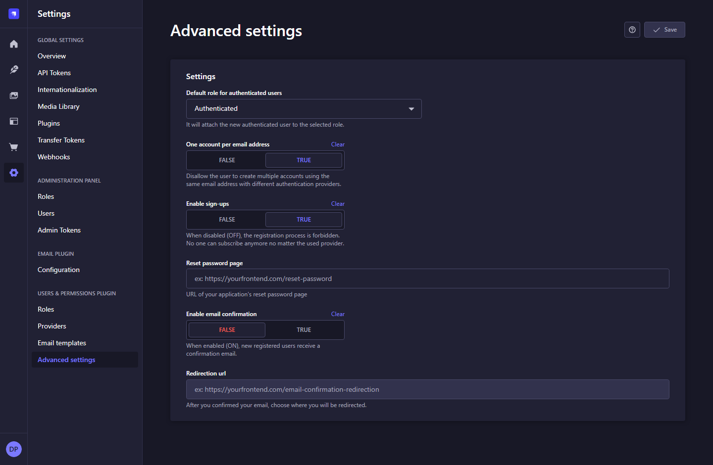

1. Controls include default registration role, one account per email, sign-ups, and confirmation settings.
2. These options affect the plugin APIs; they do not add a login UI to Next.js.
3. Change them only as part of an intentional application-authentication configuration.

**Note:** No sign-up or authentication settings were changed for the documentation.

### 8.7 Email provider configuration

**Navigation:** Settings > Email Plugin > Configuration

Inspect the active email provider and its test-delivery screen.

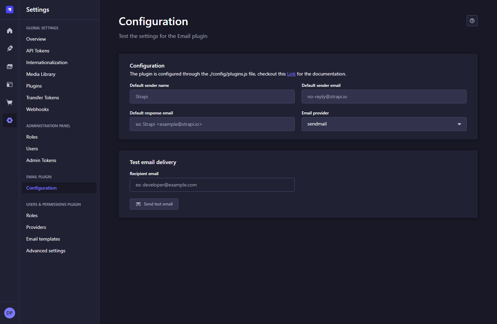

1. The local application currently reports the sendmail provider.
2. Provider configuration is managed in the CMS configuration/environment by the developer.
3. Use the test-delivery form only when you intend to send a test message.

**Note:** No test email was sent. This setup does not imply production email delivery is configured.

### 8.8 Content locales

**Navigation:** Settings > Global Settings > Internationalization

View the configured content locales.

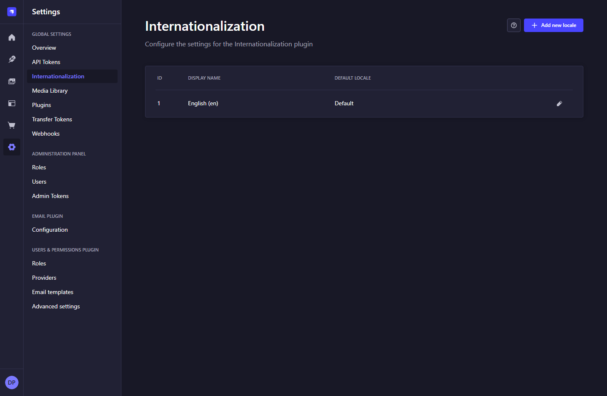

1. The current application lists English as the default locale.
2. Admin interface language is changed from your profile, not this screen.
3. Adding a locale alone does not implement translated Next.js routes or translated content models.

**Note:** The current MVP is a single-language website.

### 8.9 Media processing settings

**Navigation:** Settings > Global Settings > Media Library

Review automatic image-processing options.

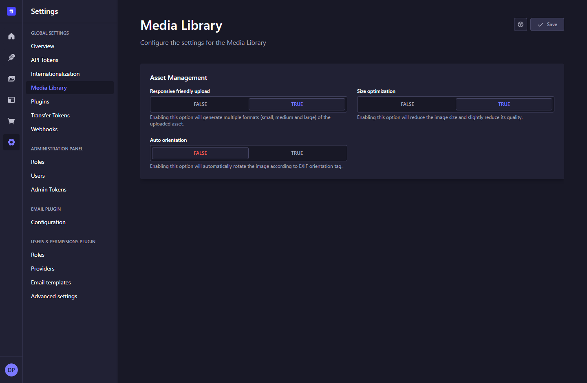

1. Responsive formats, size optimization, and auto orientation can affect new uploads.
2. Coordinate changes with the developer, especially when storage providers or image delivery rules are involved.
3. Review uploaded results after a setting change.

**Note:** These controls manage Strapi media processing, not the design of frontend image cards.

### 8.10 Installed plugins

**Navigation:** Settings > Global Settings > Plugins

Inspect the plugins available in this Strapi installation.

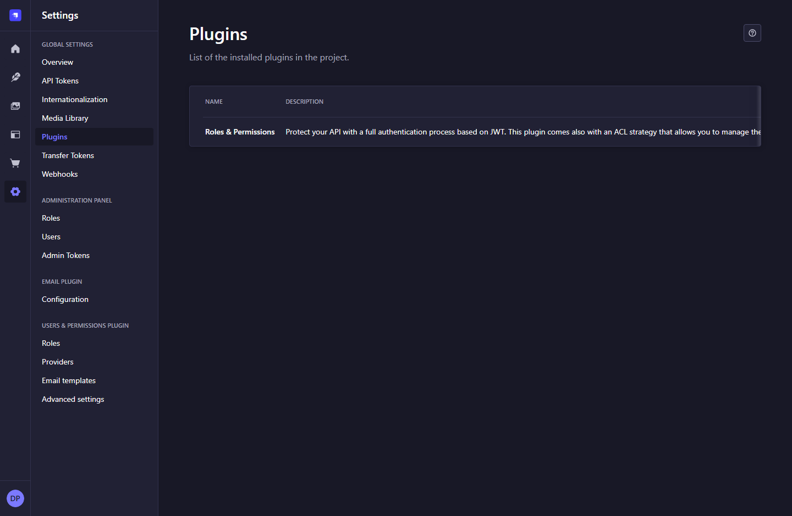

1. Use this list when communicating the current setup to a developer.
2. Plugin installation, updates, and removal belong in the development workflow.
3. The Marketplace icon opens the external Strapi marketplace rather than a project admin screen.

**Note:** External marketplace pages and paid feature onboarding are not part of this local screen guide.

### 8.11 Project transfer credentials

**Navigation:** Settings > Global Settings > Transfer Tokens

Manage credentials used for Strapi data-transfer operations.

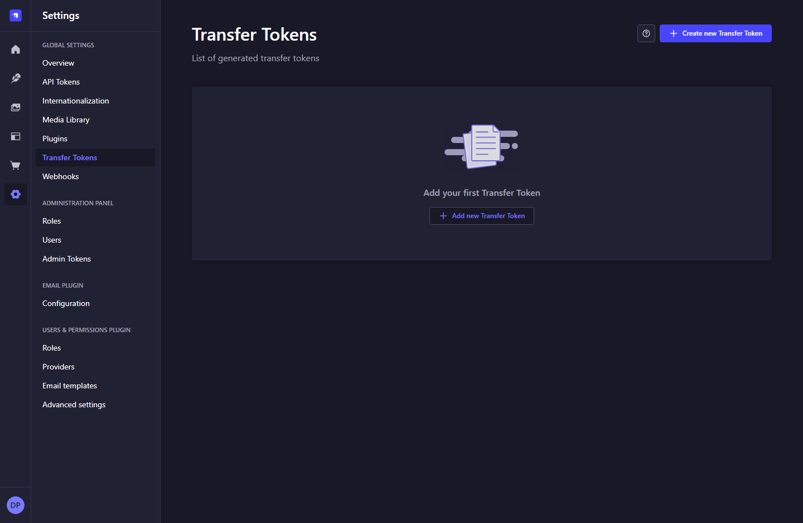

1. Review existing transfer tokens before a migration task.
2. Transfer tokens are separate from the website content and inquiry tokens.
3. Leave this screen unchanged during normal speaker/program administration.

**Note:** The MVP does not require a transfer token for daily use.

### 8.12 Create a transfer token

**Navigation:** Settings > Transfer Tokens > Create new Transfer Token

Define a credential for an intentional project data-transfer task.

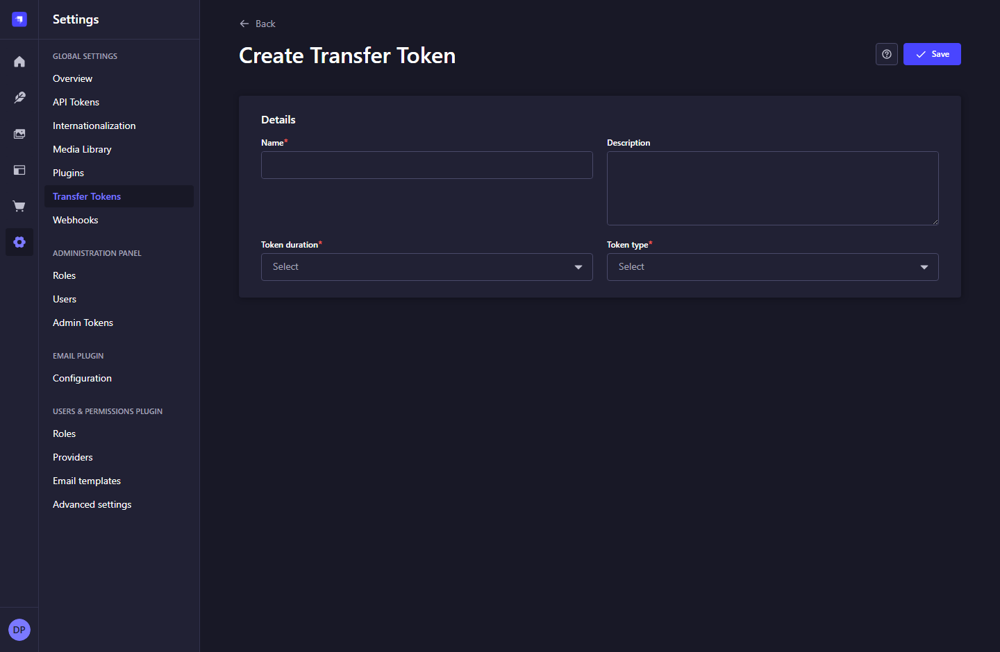

1. Provide name, description, duration, and the required transfer token type.
2. Coordinate the operation with the developer and the source/destination project owners.
3. Store the resulting credential outside public code and documentation.

**Note:** No transfer token was created and no data transfer was performed.

### 8.13 Webhook list

**Navigation:** Settings > Global Settings > Webhooks

Review configured integrations triggered by Strapi events.

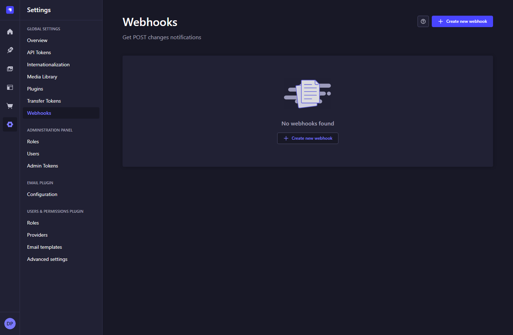

1. The current local project has no configured webhooks.
2. Publishing works without a revalidation webhook because Next.js requests current content.
3. Add an integration only when it has a concrete operational requirement.

**Note:** There are no automated CRM, email, or booking integrations in this MVP.

### 8.14 Create a webhook

**Navigation:** Settings > Webhooks > Create new webhook

Configure an explicit external event destination when required.

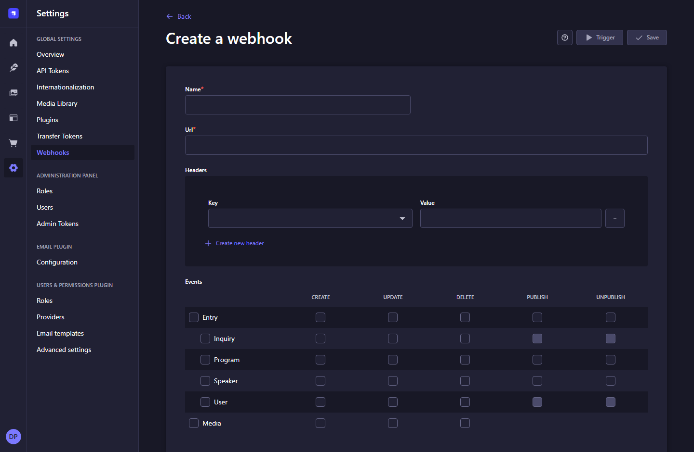

1. Provide the destination name and URL, then any required headers.
2. Select only the events and content types the receiving integration needs.
3. Review the destination and payload exposure before saving or triggering a webhook.

**Note:** No webhook was saved or triggered. This optional form is shown for completeness.

## A. Speaker field reference

| Field | Type / rule | How it is used |
| --- | --- | --- |
| name | Required text; max 150 | Public display name. |
| slug | Required unique UID | Generated from name. Public URL: /speakers/<slug>. Keep stable after publishing. |
| image | Optional; one image | Portrait used in cards and detail pages. |
| designation | Required text; max 200 | Professional title beneath the name. |
| bio | Required multiline text | Plain text, rendered as paragraphs. |
| expertise | Required text; max 250 | Comma-separated topics, e.g. Leadership, Culture, Change. |
| featured | Boolean; default FALSE | Makes a published profile eligible for the homepage. |
| programs | Many-to-many relation | Reverse links to the Program speakers field. |

Speakers and programs use Draft & Publish. Inquiries have no publication stage and remain private. Website form validation may impose minimum lengths in addition to the CMS rules.

## B. Program field reference

| Field | Type / rule | How it is used |
| --- | --- | --- |
| title | Required text; max 180 | Public program name. |
| slug | Required unique UID | Generated from title. Public URL: /programs/<slug>. |
| image | Optional; one image | Program card and detail image. A designed fallback appears when absent. |
| description | Required multiline text | Plain text with paragraph breaks; HTML is not rendered. |
| duration | Required text; max 100 | Readable duration, such as Half-day workshop. |
| speakers | Many-to-many relation | Related profiles. Publish them to display them publicly. |
| featured | Boolean; default FALSE | Makes a published program eligible for the homepage. |

Speakers and programs use Draft & Publish. Inquiries have no publication stage and remain private. Website form validation may impose minimum lengths in addition to the CMS rules.

## C. Inquiry field reference

| Field | Type / rule | How it is used |
| --- | --- | --- |
| name | Required text; max 120 | Sender name. Website form minimum: 2 characters. |
| email | Required valid email; max 254 | Address for human follow-up. |
| company | Required text; max 160 | Organization. Website form minimum: 2 characters. |
| message | Required text; max 5000 | Website form minimum: 20 characters. |
| submissionDate | Required date and time | Set on the CMS server by the inquiry intake endpoint. |

Speakers and programs use Draft & Publish. Inquiries have no publication stage and remain private. Website form validation may impose minimum lengths in addition to the CMS rules.

## D. Daily publishing checklist

### Publish a speaker from start to finish

- Create the entry in Content Manager > Speaker. Fill required fields, attach a portrait, and review the slug.
- Save the draft. Review spelling, biography paragraphs, expertise topics, and image alternative text.
- Choose Publish and confirm the entry shows Published.
- Open http://localhost:3000/speakers and select the profile, or open /speakers/<slug> directly.
- To feature it on the homepage, set featured to TRUE and publish that change.

### Program and homepage checks

- Publish related speaker profiles, link them from the program, then publish the program.
- The homepage shows up to three featured speakers and two featured programs, selected from alphabetically sorted published lists.
- More featured records can exist than the homepage displays. Drag order does not control homepage selection.
- Use the public website for final review. The admin Set up preview prompt is not connected to a custom preview workflow in this MVP.

### Inquiry intake check

- Submit a recognizable test message through the website Contact form, then confirm it appears in Content Manager > Inquiry.
- After verification, remove only the identified test record if it is no longer needed.

## E. Troubleshooting

| Symptom | Check and next action |
| --- | --- |
| Missing speaker or program | Check Published status, the correct slug, and cleared filters. Saving a draft does not update the live version. |
| Missing homepage feature | Check featured = TRUE and publish. Only 3 speakers and 2 programs appear; alphabetical selection applies. |
| Program has no speaker cards | Publish the linked speakers, verify the speakers relation, then publish the program changes. |
| Missing image | Use Add asset to attach an uploaded image to the entry. Save/publish and confirm its media URL is reachable. |
| Contact form rejected | Check required field lengths and the displayed error. SITE_URL must match the actual origin, including scheme and port. |
| Contact service unavailable | Ask the developer to check Strapi/database availability and STRAPI_INQUIRY_TOKEN. Do not expose inquiries publicly. |
| No inquiry appears | Confirm a successful form response, clear filters, and check the correct environment. A manual record does not test the contact form. |
| Admin will not load | Confirm PostgreSQL and Strapi are running. Admin uses port 1337; Next.js uses port 3000. |
| Saved edits not visible | Publish the draft, then refresh the public page. Ordinary content edits do not require a frontend rebuild. |
| Controls unavailable | Check your administrator role and environment. Some schema tools are development-only. |

## F. Access boundaries and handover

### Keep these concepts separate

- Administrator users and roles: staff who can sign in to the built-in admin.
- Users & Permissions users/roles: application-user APIs installed by the plugin; no customer login exists in this website.
- Content API tokens: server-only speaker/program reads and create-only inquiry intake.
- Admin Tokens and Transfer Tokens: optional admin automation and migration credentials; not website credentials.

### Operational checklist

- Review staff access and keep an accountable owner for Super Admin access.
- Keep Inquiry permissions disabled for Public and Authenticated roles. Restrict staff access to those who need it.
- Rotate website credentials through the developer, update server environment variables, and restart Next.js. Never put token values in client code or documentation.
- Keep database and uploaded-media backups. Agree how long inquiry data should be retained.
- Replace fictional profiles and illustrative stock portraits with approved content before a real launch.

### Project references

- README.md: installation, token permissions, configuration, and verification commands.
- LOCAL_SETUP.md: restart instructions for this machine.
- docs/admin/screenshots/: all full-resolution screenshot sources.
- docs/admin/guide-content.json and scripts/build-admin-guide.py: editable content and the regeneration script.
